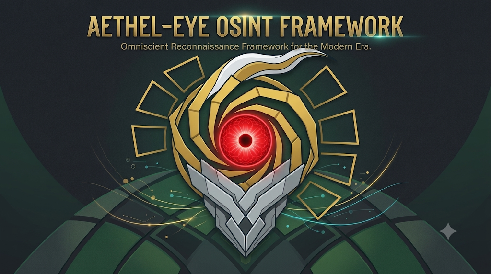

<p align="center">
  
</p>

<p align="center">
  
  
  
  
</p>

# AETHELeye - Omniscient Reconnaissance Framework for the Modern Era

**[Introduction](#introduction) | [Features](#features) | [Architecture](#architecture) | [Requirements](#requirements) | [Build](#build) | [Usage](#usage) | [Modes](#modes) | [Configuration](#configuration) | [Reports](#reports) | [License](#license)**

**AETHELeye** is an omniscient reconnaissance framework for the modern era. It unifies web OSINT and security assessment for authorized applications: robots.txt discovery, WAF fingerprinting, technology detection, hidden-path checks, source/dependency analysis, GitHub exposure review and leaked-account intelligence in one scope-aware pipeline.

The framework is built for real assessment work: targets can be domains, single applications under an IP path (`http://10.0.0.5/abc`), or local source archives (`.zip`) downloaded from a UAT environment. It supports an **offline-first** workflow for isolated networks and an **online** workflow for public OSINT sources. Results are written as evidence-ready JSON or plain-text reports.

All check names, summaries, findings and report conclusions are in English.

> AETHELeye is intended only for systems you own or are explicitly authorized to test. It records observations and candidate findings; each finding must be manually verified before it is treated as a vulnerability.

---

## Introduction

Modern web assessments usually start with a pile of disconnected scripts: one for robots.txt, one for technology fingerprints, one for exposed backups, one for GitHub, one for leaked credentials. AETHELeye replaces that with a single engine and a consistent evidence format.

The framework is check-oriented. Every check receives the same target context, scope validator, rate-limited HTTP client, logging and timeout budget. A failure in one check is isolated and recorded; the rest of the assessment continues.

AETHELeye is designed for:

- web application security assessments and UAT reviews;
- OSINT collection with a written scope;
- source-code and dependency review of downloaded archives;
- offline assessments where Internet access is unavailable but the target is reachable;
- repeatable evidence collection for reports and PoCs.

---

## Features

### Assessment engine

| Feature | Description |
|---|---|
| Scope enforcement | Every target request **and every redirect** is validated against allowed and excluded hosts. |
| SSRF protection | DNS is resolved at connect time; loopback, RFC1918 and other private ranges are blocked unless explicitly allowed. |
| Shared HTTP client | Rate limiting, retries, per-request timeout, body-size limits and user-agent configuration in one place. |
| Per-check isolation | One timeout and one failure boundary per check. A crash or timeout does not stop the scan. |
| Deterministic order | Checks run in assessment order with stable report output. |
| External request budget | Public API calls have a hard cap, short timeouts and a circuit breaker for broken networks. |
| Evidence-first findings | Every finding carries target, URL, confidence, evidence and remediation guidance. |
| Secret redaction | Tokens, API keys, proxy credentials and custom headers are removed from JSON reports. Credentials returned by leak sources are masked. |

The mode table below is the single source of truth for which checks run. Use
`aetheleye checks` to print every check ID with a one-line description.

---

## Architecture

```text
src/
  AethelEye.Core/
    Abstractions/   ICheck, ICheckContext, ILog
    Models/         Target, Finding, CheckResult, Engagement, ScanReport
    Engine/         ScanOrchestrator, CheckContext
    Scope/          ScopeValidator
    Http/           ScopedHttpClient, ExternalHttpClient, PageCache, rate limiter, evasion profile
    Tools/          ExternalToolRunner (git, gitleaks, Python/Go tools)
    Reporting/      JSON, plain text
  AethelEye.Modules/
    Recon/          DNS/SPF/DMARC, RDAP, Certificate Transparency, social
    Robots/         robots.txt + sensitive Disallow
    Waf/            WAF/CDN fingerprint (wafw00f-inspired)
    Technology/     WappalyzerSharp + RetireSharp + optional headless Chromium
    HiddenPaths/    .git, .env, backup, SQL dump, debug endpoint
    Source/         local dir/.zip/JS/manifest scan against the advisory database
    Advisories/     SQLite OSV/Retire/KEV/EPSS store
    GitHub/         repository/code search + optional gitleaks
    LeakedAccounts/ HudsonRock + ProxyNova + BreachDirectory + dorks
  AethelEye.Cli/     aetheleye command
```

### Pipeline

```text
engagement.json / CLI flags
        |
        v
  Target + Scope validation
        |
        v
  ScanOrchestrator (order, timeout, error isolation)
        |
        +--> dns / rdap --------+
        +--> subdomains --------+
        +--> robots -------------+
        +--> waf ----------------+
        +--> technology ---------+--> Findings + CheckResult
        +--> social -------------+
        +--> hidden-paths -------+
        +--> source -------------+
        +--> github -------------+
        +--> leaked-accounts ----+
        |
        v
  JSON or plain-text reports
```

---

## Requirements

- **.NET SDK 10** (the projects target `net10.0`).
- Windows or Linux.
- Optional: `GITHUB_TOKEN` for GitHub code search.
- Optional: `gitleaks` executable for GitHub clone-and-scan.
- Optional: Chromium or Edge for `--chromium` runtime technology detection.
- Optional: SQLite is built into Windows 10+ and most Linux distributions; no extra package is needed.
- PowerShell examples below; use the equivalent shell syntax on Linux.

No NuGet package restore is required by AETHELeye itself. The referenced `WappalyzerSharp` and `RetireSharp` projects are local project references.

---

## Build

```powershell
git clone <your-repository-url> AETHELeye
cd AETHELeye

dotnet build AethelEye.slnx -c Release
```

Publish a framework-dependent Windows executable:

```powershell
dotnet publish src/AethelEye.Cli -c Release -r win-x64 --self-contained false -o publish
.\publish\aetheleye.exe --help
```

Publish for Linux:

```powershell
dotnet publish src/AethelEye.Cli -c Release -r linux-x64 --self-contained false -o publish
./publish/aetheleye --help
```

Run from source during development:

```powershell
dotnet run --project src/AethelEye.Cli -- --url example.com --mode all
```

---

## Usage

### CLI banner

Typing the command name shows the AETHELeye ASCII identity:

```powershell
aetheleye
aetheleye banner
aetheleye --help
```

```text
  ###   #####  #####  #   #  #####  #        #####  #   #  #####
 #   #  #        #    #   #  #      #        #       # #   #
 #####  ####     #    #####  ####   #        ####     #    ####
 #   #  #        #    #   #  #      #        #        # #   #
 #   #  #####    #    #   #  #####  #####    #####    #    #####
                                  (o)
        Omniscient Reconnaissance Framework for the Modern Era
        v0.1.0  |  GPL-3.0  |  authorized testing only
```

Use `--no-banner` for CI logs and automation.

### Quick start

```powershell
# Build the local advisory database once
aetheleye --update db

# Full web assessment (online by default)
aetheleye --url example.com --mode all

# Domain-level checks only
aetheleye --url example.com --mode dns,rdap,subdomains,social

# JavaScript-heavy page: render it before fingerprinting
aetheleye --url example.com --mode technology --chromium --timeout 30

# One target, one check
aetheleye --url example.com --mode waf
aetheleye --url example.com --mode github
aetheleye --url example.com --mode leaked-account

# Offline minimal assessment
aetheleye --url example.com --mode web --offline

# Multiple applications on one authorized UAT IP
aetheleye --url http://10.0.0.5/abc --url http://10.0.0.5/xyz --mode all --allow-uat

# Local source archive or directory
aetheleye --src C:\downloads\abc.zip --mode source
aetheleye --src C:\downloads\abc --mode source

# Web + source in one report
aetheleye --url example.com --src C:\downloads\abc.zip --mode all
```

### Output

By default, a plain-text report is written to:

```text
results/<engagement-name>-<timestamp>.txt
```

Use `--out` and `--format` to choose text, JSON or both:

```powershell
aetheleye --url example.com --mode all --out poc\online --format json
aetheleye --url example.com --mode all --out poc\online --format text,json
```

For a prioritized report, `--exploited` keeps only High/Critical findings:

```powershell
aetheleye --url example.com --mode all --exploited --out results\critical
```

### Common options

| Option | Description |
|---|---|
| `--url <value>` | Web target. Repeatable; comma-separated values are accepted. |
| `--src <path>` | Local source directory, `.zip` (extracted locally), JavaScript file or manifest file. Repeatable. |
| `--mode <list>` | Check mode(s). Default: `all`. |
| `--update db` | Download OSV/Retire/Node/KEV/EPSS feeds into SQLite and refresh Wappalyzer fingerprints. |
| `--db <path>` | Advisory database file (default: `<data dir>/aetheleye.db`). |
| `--offline` | Offline scan. No GitHub/leak APIs or live feeds. |
| `--chromium [path]` | Enable headless Chromium; optionally give the executable path. |
| `--timeout <sec>` | HTTP and headless navigation timeout. |
| `--concurrency <n>` | Parallel targets (default: 1). |
| `--random-agent` | Rotate a browser User-Agent for every target request. |
| `--authen <file>` | Raw Burp header block with `Cookie`/`Authorization` for authenticated scans. |
| `--name-token <name>` | Extra backup filename stem (repeatable/comma-separated). Path tokens are automatic; an IP is never split into octets. |
| `--evasion` | Low-and-slow, browser-like requests for authorized WAF/IDS testing. |
| `--allow-uat` | UAT preset: private/loopback hosts, self-signed TLS and non-standard ports. |
| `--out <dir>` | Output directory. |
| `--format <list>` | `text` (default) or `json`; comma-separated for both. |
| `--exploited` | Keep only High/Critical findings in the report. |
| `--deep` | Enable RetireSharp AST-based JavaScript detection (slower). |
| `--verbose` | Show check details, evidence and internal HTTP retries. |

---

## Modes

Use a mode to choose the assessment workflow. Individual check names are also accepted as mode
tokens.

| Mode | Checks | When to use |
|---|---|---|
| `all` | Everything selected for the inputs; adds `source` when `--src` is present. | Default full assessment. |
| `web` | `dns`, `rdap`, `subdomains`, `social`, `robots`, `sitemap`, `cms`, `waf`, `technology`, `security`, `exposure`, `hidden-paths`, `backup`. | A web/domain assessment without GitHub, leak APIs or local source. |
| `technology` | `technology`, `cms`, `exposure`. | Technology fingerprint, CMS detection and default-page/API/Actuator/debug exposure. |
| `external` | `github`, `leaked-accounts`. | Public repository and leaked-account OSINT. |
| `source` | Local source/dependency scan against the advisory database. | A downloaded source tree or `.zip`. |

Quick legend: `dns`/`rdap`/`subdomains`/`social` are domain intelligence;
`robots`/`sitemap` are crawl hints; `cms`/`waf`/`technology` are fingerprinting;
`security` is headers/cookies/`security.txt`; `exposure` is default admin/API/Tomcat/Swagger/
Actuator/debug pages; `hidden-paths`/`backup` are exposed files; `github`/`leaked-accounts` are
external OSINT; `source` is local code/dependency analysis.

Accepted aliases: `github`, `leaked-account`, `robots`, `waf`, `technology`, `hidden-paths`,
`cms`, `wordpress`, `joomla`, `drupal`, `magento`, `exposure`, `swagger`, `actuator`, `tomcat`,
`debug`, `security`, `headers`, `cookies`, `sitemap`, `backup`, `backups`, `dns`, `rdap`,
`subdomains`, `social`; older names `leaked`, `leaks`, `tech`, `wafw00f`, `hidden`, `paths`, `src`,
`code`, `deps`.

### Check-level modes

Any check ID can be used directly as a `--mode` token. This is how you run a subset without a
predefined workflow:

```powershell
# Domain intelligence only: DNS/SPF/DMARC/DNSSEC, RDAP, Certificate Transparency, social contacts
aetheleye --url example.com --mode dns,rdap,subdomains,social

# Security posture and sitemap only
aetheleye --url example.com --mode security,sitemap

# Backup archives only, with an explicit name token
aetheleye --url http://10.0.0.5/xyz --mode backup --name-token xyz --allow-uat

# Technology/CMS/default-page exposure only
aetheleye --url example.com --mode technology

# Individual checks can be combined freely
aetheleye --url example.com --mode robots,waf,technology,security,backup
```

Run `aetheleye checks` to print every check ID with a one-line description.

---

## Typical workflows

### 1. Online assessment of a public domain

```powershell
$env:GITHUB_TOKEN = "ghp_..."
aetheleye --url example.com --mode all --out results\online
```

The `github` check becomes `Partial` when code search is enabled but no token is available. Set a token for a complete result.

### 2. Offline UAT with multiple apps on one IP

```powershell
aetheleye `
  --url http://10.0.0.5/abc `
  --url http://10.0.0.5/xyz `
  --mode all `
  --offline `
  --allow-uat `
  --out results\uat
```

Each path is treated as a separate application:

- `http://10.0.0.5/abc/robots.txt` (with root fallback)
- `http://10.0.0.5/abc/.git/HEAD`
- `http://10.0.0.5/abc/backup.zip`
- the same checks under `/xyz/`

`--allow-uat` already permits private/loopback hosts, self-signed TLS and non-standard ports.

### 3. Authenticated scan from a Burp header capture

Log in with Burp or the browser, copy the request headers, and save them to a local text file:

```text
GET /dashboard HTTP/1.1
Host: app.example.com
Cookie: session=...; csrf=...
Authorization: Bearer ...
Accept: text/html,application/xhtml+xml
```

Run the scan with `--authen`. The parser ignores the request line, `Host`, `Content-Length` and
connection-level headers, and applies `Cookie`, `Authorization` and other application headers to
target requests:

```powershell
aetheleye --url https://app.example.com --mode web --authen C:\cases\app-headers.txt
```

The file is read locally. Header values are never printed in verbose output or written to the
text/JSON report. Only send headers for accounts and systems you are authorized to test.

### 4. Backup archives for an application under an IP path

For `http://10.0.0.5/xyz`, the path segment `xyz` is used automatically as the backup stem.
`--name-token` adds more stems. An IP address is used whole (`10.0.0.5.zip`); it is never split into
`10.zip` or `10.0.zip`.

```powershell
aetheleye --url http://10.0.0.5/xyz --mode backup --allow-uat
aetheleye --url http://10.0.0.5/xyz --mode backup --name-token xyz,backup --allow-uat
```

### 5. Downloaded source archive

`--src` points at a **local** path. If a site exposes `http://10.0.0.5/abc.zip`, download it
manually first, then scan the local archive:

```powershell
# a folder is the normal case
aetheleye --src C:\downloads\abc --mode source --out results\source

# a local .zip is extracted to a temporary folder, scanned, then deleted
aetheleye --src C:\downloads\abc.zip --mode source --out results\source
```

The tool never downloads the zip from the target. Zip extraction is local and protected against
zip-slip, symlinks, oversized entries and too many entries.

You can also add the file to the hidden-path check:

```json
"checks": {
  "hidden-paths": {
    "options": { "paths": ["/abc.zip"] }
  }
}
```

### 6. Source and the local advisory database

Build the SQLite database once on a connected machine, then copy the single `.db` file to the
isolated assessment machine:

```powershell
# connected machine
aetheleye --update db

# optional custom location
aetheleye --update db --db D:\aetheleye\aetheleye.db

# isolated machine: copy the .db file, then scan without Internet
aetheleye --src C:\downloads\abc --mode source --offline --db D:\aetheleye\aetheleye.db
```

The database stores the Retire repository plus OSV, Node.js, CISA KEV and EPSS feeds. Source and
technology findings gain CVE/GHSA identifiers, KEV/EPSS context and public PoC references when the
feed carries them. There is no suppression list: every vulnerable component is reported.

### 7. Domain-level checks

```powershell
aetheleye --url example.com --mode dns,rdap,subdomains,social
```

These are passive domain checks: DNS-over-HTTPS, RDAP, Certificate Transparency and public page
contacts. They do not evaluate TLS, port-scan or brute-force directories. Run them together with
the target web checks through `--mode web`, or select them by name in `--mode`.

### 8. GitHub and leaked accounts

```powershell
aetheleye --url example.com --mode github
aetheleye --url example.com --mode leaked-account
aetheleye --url example.com --mode leaked-account,github --offline
```

In offline mode both checks are reported as `Skipped`. A skipped check is **not** evidence of "no risk"; run it online or document that it was not assessed.

### 9. WAF fingerprint

```powershell
aetheleye --url example.com --mode waf
```

WAF detection is information, not a vulnerability. To disable the safe active probe:

```json
"checks": {
  "waf": {
    "options": { "activeProbe": false }
  }
}
```

### 10. Why `--src` and `--mode github,leaked-account` do not combine

```powershell
# Wrong: GitHub/leaked checks need a web domain, not a local source path
aetheleye --src .\src --mode leaked-account,github --offline

# Correct: web checks use --url
aetheleye --url example.com --mode leaked-account,github --offline

# Correct: source checks use --src
aetheleye --src .\src --mode source --offline

# Correct: combine both explicitly
aetheleye --url example.com --src .\src --mode all --offline
```

---

## Configuration

### Engagement file

`engagement.json` is the portable assessment definition. `aetheleye init acme` creates a starter file.

```json
{
  "name": "acme-web",
  "client": "ACME",
  "authorizedBy": "Written authorization reference",
  "offline": false,
  "targets": ["https://example.com"],
  "sources": ["C:\\downloads\\abc.zip"],
  "scope": {
    "allowedHosts": ["example.com"],
    "excludedHosts": [],
    "includeSubdomains": true,
    "allowPrivateAddresses": false,
    "allowNonStandardPorts": true
  },
  "advisoryDatabasePath": null,
  "http": {
    "timeoutSeconds": 20,
    "requestsPerSecond": 5,
    "retries": 2,
    "externalTimeoutSeconds": 12,
    "externalRetries": 1,
    "maxExternalRequests": 100,
    "evasion": false
  },
  "browser": {
    "headless": false,
    "chromiumPath": null,
    "disableSandbox": false,
    "timeoutSeconds": 20
  },
  "engine": {
    "targetConcurrency": 1,
    "defaultCheckTimeoutSeconds": 120
  },
  "checks": {
    "waf": { "options": { "activeProbe": true } },
    "technology": { "options": { "maxScripts": 40, "favicon": true, "deep": false, "focus": "all" } },
    "hidden-paths": { "options": { "parallelism": 4 } },
    "source": { "options": { "maxFindings": 200, "deep": false, "focus": "all" } },
    "github": { "options": { "cloneAndScan": false } }
  },
  "output": {
    "directory": "results",
    "formats": ["text"],
    "fileName": "aetheleye-report"
  }
}
```

Run it with:

```powershell
aetheleye engagement.json
```

### appsettings.json

Secrets belong in `appsettings.json` or `appsettings.local.json`, not in the engagement file. Environment variables override both.

```json
{
  "AethelEye": {
    "GitHubToken": "",
    "BreachDirectoryApiKey": "",
    "GitleaksPath": "C:\\tools\\gitleaks.exe",
    "Proxy": "",
    "UserAgent": "",
    "MaxExternalRequests": 100,
    "DataDirectory": "C:\\aetheleye-cache"
  }
}
```

Precedence:

```text
CLI flags > environment variables > appsettings.local.json > appsettings.json > defaults
```

Supported environment variables: `GITHUB_TOKEN`, `BREACHDIRECTORY_API_KEY`, `GITLEAKS_PATH`, `HTTP_PROXY`, `HTTPS_PROXY`.

### Cache

The SQLite advisory database, Wappalyzer fingerprints and Retire repository cache are stored under
`DataDirectory` (`%LOCALAPPDATA%\aetheleye` by default). For an offline run, build them once online:

```powershell
aetheleye --update db
aetheleye --url example.com --mode all --offline
```

Copy `aetheleye.db` and `wappalyzer-fingerprints.json` to the isolated machine if needed.

---

## Reports

### JSON

Machine-readable, suitable for CI and evidence pipelines. The report contains:

- engagement metadata and safe scan settings;
- per-target and per-check results;
- findings with severity, confidence, evidence, remediation and references;
- check metrics, notes and conclusions.

Secrets (GitHub token, BreachDirectory key, proxy credentials and custom headers) are not written to the report.

### Text

Human-readable plain text with a check summary and detailed findings. Each check includes:

- status (`NoRisk`, `Findings`, `Partial`, `Skipped`, `Failed`, `TimedOut`, `Cancelled`);
- conclusion;
- duration and summary;
- notes and metrics;
- findings ordered by severity.

Example conclusion:

```text
No risk identified at the time of assessment.
```

`Partial` and `Skipped` must not be reported as "no risk"; they mean the check did not complete or was not run.

---

## Security model

- **Authorization first.** Only scan systems you own or are explicitly authorized to test.
- **Scope is enforced in code.** Every request and redirect is validated against `allowedHosts` and `excludedHosts`.
- **Private addresses are blocked by default.** Use `--allow-uat` only for an authorized UAT/lab target.
- **DNS resolution happens at connect time.** A hostname that resolves to loopback or a private range is rejected unless private addresses are allowed.
- **Reports are redacted.** API keys, tokens, proxy credentials and custom headers are omitted. Leak-source credentials are masked.
- **Online by default.** Use `--offline` for an isolated network. Offline mode makes external calls fail fast; it does not silently fall back to Internet sources.
- **Findings are observations.** Manual verification is required before reporting a vulnerability.

---

## Offline and online behavior

| Capability | Online | `--offline` |
|---|---|---|
| `dns`, `rdap`, `subdomains` | Runs | `dns` local A/AAAA only; others `Skipped` |
| `robots`, `sitemap`, `waf`, `technology`, `security`, `social`, `hidden-paths`, `backup` | Runs | Runs |
| Advisory database refresh | `--update db` downloads feeds | Existing database only |
| `source` scan | Runs | Runs with the local database |
| GitHub search | Runs | `Skipped` |
| Leaked-account APIs | Runs | `Skipped` |
| WAF active probe | Runs | Runs (target-only) |
| External request budget | 100 calls, short timeout, circuit breaker | No calls |

For an isolated network, run `aetheleye --update db` on a connected machine and copy the `.db`
file. Then use `--offline --db <path>`.

---

## Third-party notices

AETHELeye builds on and adapts open-source work. [`THIRD-PARTY-NOTICES.md`](THIRD-PARTY-NOTICES.md)
lists every third-party component, the license it uses and a link to the upstream license text.
Third-party license texts are not duplicated in this repository; the root [`LICENSE`](LICENSE)
is AETHELeye's own GPL-3.0 license.

Summary:

| Component | License | Relationship |
|---|---|---|
| WappalyzerSharp / wappalyzergo | MIT | referenced library |
| Wappalyzer fingerprint data | GPL-3.0 (upstream) | embedded in WappalyzerSharp |
| RetireSharp / retire.js / ASTronomical | Apache-2.0 | referenced library + runtime data feed |
| gitleaks | MIT | optional external binary |
| gosearch domain-leak/dorks | GPL-3.0 | C# port in `LeakedAccounts` |
| omnisci3nt | MIT | DNS, RDAP, subdomain and social module reference |
| CMSeeK | GPL-3.0 | CMS detection and version-file reference |
| recon-web | GPL-2.0-or-later | security-header, cookie, sitemap and security.txt reference |
| wafw00f | BSD-3-Clause | WAF signature reference |
| .NET / System.Text.Json | MIT | runtime / BCL |

---

## License

AETHELeye is released under the **GNU General Public License v3.0**.

See [`LICENSE`](LICENSE) for the full text. The GPL-3.0 license is compatible with the GPL-3.0 portions of this project (gosearch domain-leak logic and Wappalyzer fingerprint data). Review `THIRD-PARTY-NOTICES.md` before redistributing binaries.

---

<p align="center">
  <sub>AETHELeye - scope-aware web OSINT, built for evidence.</sub>
</p>
